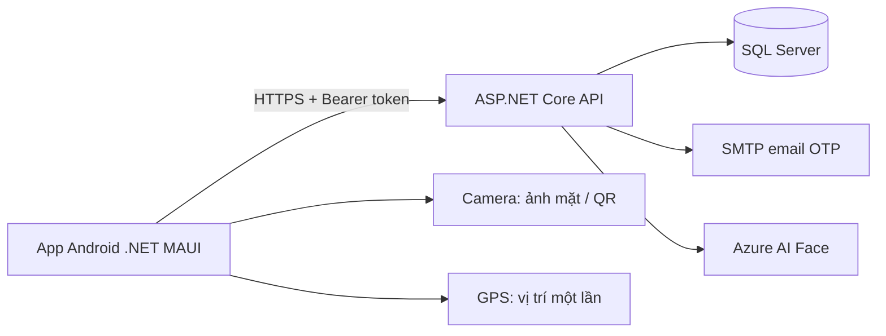
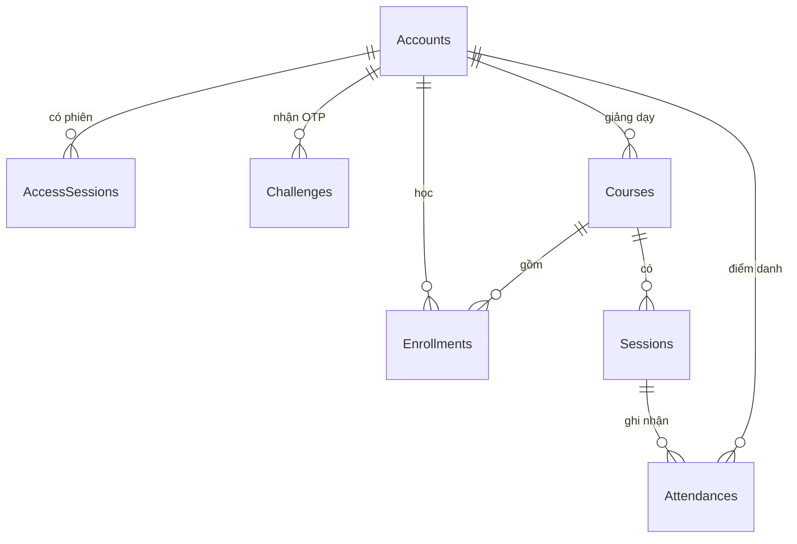

# Thiết kế và đối chiếu bài tập

## Kiến trúc

- `src/DoanTrungHieu_2380600643`: giao diện C# MAUI, quyền camera/GPS, lưu phiên trong Android SecureStorage.
- `src/DoanTrungHieu_2380600643.Contracts`: DTO và validation chung.
- `src/DoanTrungHieu_2380600643.Api`: controller nghiệp vụ, kiểm tra quyền tại server, EF Core SQL Server, SMTP và Azure Face.
- `tests/DoanTrungHieu_2380600643.Checks`: bộ kiểm tra HTTP tự chạy; database SQLite tách riêng, email/Face test doubles. Không chứa đường tắt xác thực trong production.

## Mô hình dữ liệu

Khóa duy nhất: UserName, Email, Code lớp, cặp CourseId/StudentId và cặp SessionId/StudentId. Token chỉ lưu SHA-256 trong database; mật khẩu/OTP băm bằng PasswordHasher (PBKDF2, salt ngẫu nhiên). OTP dùng optimistic concurrency chống đổi cùng một mã thành hai phiên. Điểm danh và thay đổi buổi học dùng transaction Serializable cùng unique index chống trùng và tranh chấp dữ liệu.

## Phân quyền

| Hành động | Admin | Giảng viên | Sinh viên |
| --- | --- | --- | --- |
| Tài khoản | Xem, sửa vai trò, khóa, xóa tài khoản chưa có liên kết | Hồ sơ cá nhân | Hồ sơ cá nhân |
| Lớp | CRUD, xếp sinh viên | Xem lớp phụ trách, danh sách sinh viên | Xem lớp đang học |
| Buổi học | CRUD, QR, đóng buổi | Cùng chức năng trong lớp phụ trách | Xem lịch lớp mình |
| Điểm danh | Xem toàn hệ thống | Xem lớp phụ trách | Tự quét QR, xem lịch sử của mình |
| CSV | Mọi lớp | Chỉ lớp phụ trách | Không |
| Khuôn mặt | Đăng ký/xóa của chính mình | Như admin | Như admin |

Giao diện ẩn thao tác theo vai trò; API vẫn kiểm tra quyền độc lập. Vai trò đọc lại từ database khi xác thực từng request. Cập nhật tài khoản thu hồi toàn bộ phiên; tự hạ quyền/khóa admin đang dùng bị chặn. Đăng ký tự do luôn là Student. Tài khoản chưa xác thực email không được thêm vào lớp.

## Điểm danh

1. Giảng viên tạo buổi thuộc lớp mình với vị trí tâm lớp, bán kính và thời gian UTC.
2. QR được bảo vệ bằng ASP.NET Data Protection; nội dung gồm ID buổi và hạn hết hiệu lực tối đa 5 phút, không chứa thông tin sinh viên.
3. Sinh viên quét bằng camera, xác nhận chia sẻ vị trí. Backend kiểm tra role, enrollment, buổi đang mở, QR, tọa độ hữu hạn, GPS mới trong 60 giây, độ chính xác ≤ min(bán kính, 100 m), khoảng cách Haversine ≤ bán kính, chưa có lượt điểm danh.
4. Server lấy thời gian nhận yêu cầu để xác định Present/Late. Đồng hồ client không quyết định thời điểm điểm danh.
5. Sau khi có điểm danh không được sửa GPS/thời gian hoặc xóa buổi để bảo toàn dữ liệu. Buổi có thể đóng sớm sau khi đã bắt đầu.

GPS giả lập do SDK báo bị từ chối; client tùy biến vẫn có thể khai tọa độ giả. QR có thể được chia sẻ trong 5 phút, vì vậy cách làm này giảm gian lận, không chứng minh chống gian lận tuyệt đối. Bản nâng cấp có thể dùng device attestation và liveness.

## Kế hoạch chuyên cần

Đề xuất cho mục 6: ngoài tỷ lệ đã đi học, cho biết **còn phải đi bao nhiêu buổi** và có còn khả năng đạt yêu cầu hay không.

- Mục tiêu = ceil(số buổi kế hoạch × phần trăm yêu cầu / 100).
- Đã học = buổi Closed hoặc đã qua EndsUtc.
- Đã dự = Present + Late trong các buổi đã học.
- Còn cần = max(0, mục tiêu − đã dự).
- Còn lại = max(0, kế hoạch − đã học).
- Critical khi còn cần > còn lại; Warning khi còn cần gần bằng số buổi còn lại; Safe nếu còn đủ khoảng dự phòng hoặc đã đạt mục tiêu.

Để không tạo vắng giả khi sinh viên tham gia giữa kỳ, bản bài tập chặn thêm/xóa enrollment sau khi lớp có buổi kết thúc; cần thực hiện xếp lớp trước khi bắt đầu học. Quy định hiện tại tính đi muộn là đã dự; có thể sửa `AttendanceRules.Risk`/query nếu trường yêu cầu quy đổi khác.

## Nhận diện khuôn mặt và dữ liệu riêng tư

Azure Face lưu mẫu PersonGroup/Person; SQL chỉ giữ PersonId. Enrollment yêu cầu consent và OTP gần đây. API từ chối ảnh có nhiều/không có khuôn mặt. Verify yêu cầu đúng PersonId và confidence ≥ 0.7. Ảnh đầu vào chỉ xử lý trong bộ nhớ backend. App cố gắng xóa ảnh tạm trong cache sau khi gửi; ứng dụng camera hệ thống có thể có hành vi lưu ảnh riêng theo thiết bị.

Chưa có liveness. Đăng nhập khuôn mặt luôn phải hoàn thành thêm email OTP, không cấp token chỉ từ ảnh khớp. Tài nguyên Face cần được Azure cho phép nhận diện. Không có khóa Azure/SMTP thật trong source.

Data Protection keys nằm tại `App_Data/keys`; giữ riêng và sao lưu khi triển khai. Với nhiều API instance, phải dùng key ring chung, quyền filesystem phù hợp và mã hóa khóa khi lưu. Không đưa App_Data vào báo cáo/source nộp bài. API này là phạm vi bài tập, chưa có trang quản trị vận hành, quy trình phục hồi mật khẩu, liveness, attestation hay cơ chế migration dữ liệu.

## API chính

| Phương thức / đường dẫn | Mục đích |
| --- | --- |
| POST /api/auth/register | Đăng ký sinh viên và gửi OTP |
| POST /api/auth/login | Kiểm tra mật khẩu, gửi OTP |
| POST /api/auth/otp | Kiểm tra OTP và cấp access token |
| GET /api/auth/me | Hồ sơ phiên hiện tại |
| POST /api/auth/logout | Xóa phiên ở server |
| POST /api/auth/face/enroll | Đăng ký khuôn mặt |
| POST /api/auth/face/login | So khớp ảnh, gửi OTP |
| DELETE /api/auth/face | Xóa mẫu |
| GET, PUT, DELETE /api/users[/id] | Quản trị tài khoản |
| GET, POST, PUT, DELETE /api/courses[/id] | Lớp học |
| GET, POST, DELETE /api/courses/id/students[/student] | Danh sách lớp |
| GET, POST, PUT, DELETE /api/sessions[/id] | Buổi học |
| GET /api/sessions/id/qr | QR hạn ngắn |
| POST /api/sessions/id/close | Đóng buổi |
| POST /api/attendance/check-in | Gửi QR và GPS |
| GET /api/attendance[?sessionId=...] | Kết quả theo quyền |
| GET /api/attendance/risks | Kế hoạch cá nhân |
| GET /api/attendance/report/courseId | CSV chuyên cần gồm có mặt, muộn, vắng |

Header phiên: `Authorization: Bearer <AccessToken>`. AccessToken hết hạn sau 12 giờ; logout hoặc admin thay đổi tài khoản sẽ thu hồi ngay. Không có refresh token; hết phiên cần đăng nhập OTP lại.
